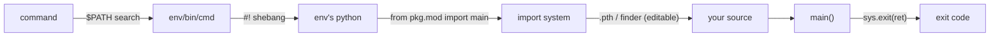

# Cheat sheet — How a Python CLI command runs

Source lesson: [0001 — What happens when you type `gpsviz`](../lessons/0001-what-happens-when-you-type-gpsviz.md)

## The chain



## Declare a command

```toml
# pyproject.toml
[project.scripts]
mycmd = "mypkg.cli:main"      # command = "module:function"
```

Install (in the active env): `uv pip install --python "$CONDA_PREFIX/bin/python" -e .`

## `main()` template

```python
def main(argv: list[str] | None = None) -> int:
    args = build_parser().parse_args(argv)   # None → sys.argv[1:]
    ...
    return 0                                 # int or None; never a str
```

```python
# mypkg/__main__.py  →  enables `python -m mypkg`
import sys
from .cli import main
sys.exit(main())
```

## Needs a reinstall?

| Change | Reinstall? |
|---|---|
| Python code in the package (editable install) | No |
| `[project.scripts]` entry added/renamed | **Yes** |
| Dependencies / version / metadata | **Yes** |
| Moved the project folder | **Yes** (finder holds the old path) |

## Debug commands

| Question | Command |
|---|---|
| Which file runs? | `which -a mycmd` |
| Which interpreter? | `head -1 "$(which mycmd)"` |
| What does the wrapper do? | `cat "$(which mycmd)"` |
| Where is the package imported from? | `python -c "import mypkg; print(mypkg.__file__)"` |
| Declared entry points | `cat $CONDA_PREFIX/lib/python3.*/site-packages/mypkg-*.dist-info/entry_points.txt` |
| Exit code of last command | `echo $?` |
| Bypass $PATH / wrapper | `python -m mypkg …` |

## Exit codes via `sys.exit(x)`

| `x` | Exit code |
|---|---|
| `None` / `0` | 0 (success) |
| `int n` | n |
| `"text"` | 1, text printed to stderr |

Specs: [entry points](https://packaging.python.org/en/latest/specifications/entry-points/) · [pyproject scripts](https://packaging.python.org/en/latest/guides/writing-pyproject-toml/#creating-executable-scripts) · [`__main__`](https://docs.python.org/3/library/__main__.html)
